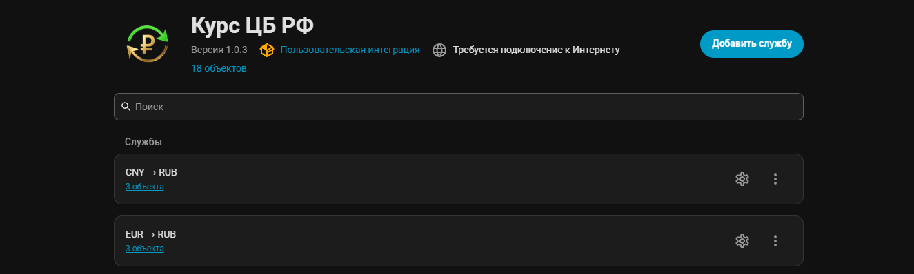

# Курсы ЦБ РФ
Небольшая интеграция для Home Assistant, которая позволяет видеть курсы любых валют, а также золота и серебра, в вашем HA (создает сенсоры). Данные берет из официального API ЦБ РФ.

**Важно:** часть кода интеграции создана с участием ИИ. Возможны баги.

## Способ 1: Установка с помощью Marketplace (рекомендуется)

1. Перейдите в Настройки → Marketplace.
2. Нажмите "Добавить по ссылке".
3. Введите https://github.com/snitivan/ha-kursometr_pro
4. Перейдите в раздел "Просмотр" и введите "Курсометр".
5. Установите интеграцию (⋮ → Установить).
6. Перед вами должно открыться окно мастера настройки. Если оно не открылось, перейдите в Настройки → Устройства и службы → Добавить интеграцию и введите "Курсометр".
7. Нажмите "Добавить запись". В окне укажите нужную валюту и время обновления в секундах (по умолчанию 3600 сек - 1 час).
8. Готово!

## Способ 2: Установка с помощью Marketplace через кастомный репозиторий
1. Перейдите в Настройки → Marketplace.
2. Перейдите в раздел "Просмотр" и введите "Курсометр". 
3. Установите интеграцию (⋮ → Установить).
4. Перед вами должно открыться окно мастера настройки. Если оно не открылось, перейдите в Настройки → Устройства и службы → Добавить интеграцию и введите "Курсометр".
5. Выполните шаг 7 из способа 1.

После установки через способ 1 или 2, обновления будут прилетать через Marketplace сами при условии, что сервер HA подключён к сети Интернет. Для работы интеграции интернет тоже нужен.
## Способ 3: Вручную (не рекомендуется)
1. Скопируйте папку custom_components/kursometr в каталог конфигурации Home Assistant.
2. Перезагрузите Home Assistant.
3. Перейдите в Настройки → Устройства и службы → Добавить интеграцию и введите «Курсометр».
4. Выполните шаг 7 из способа 1.

Если вы установите интеграцию способом 3, обновляться она не будет. Вам придётся обновлять её самому.

**Если вам понравилась интеграция, пожалуйста, поставьте звезду. Заранее спасибо!**
